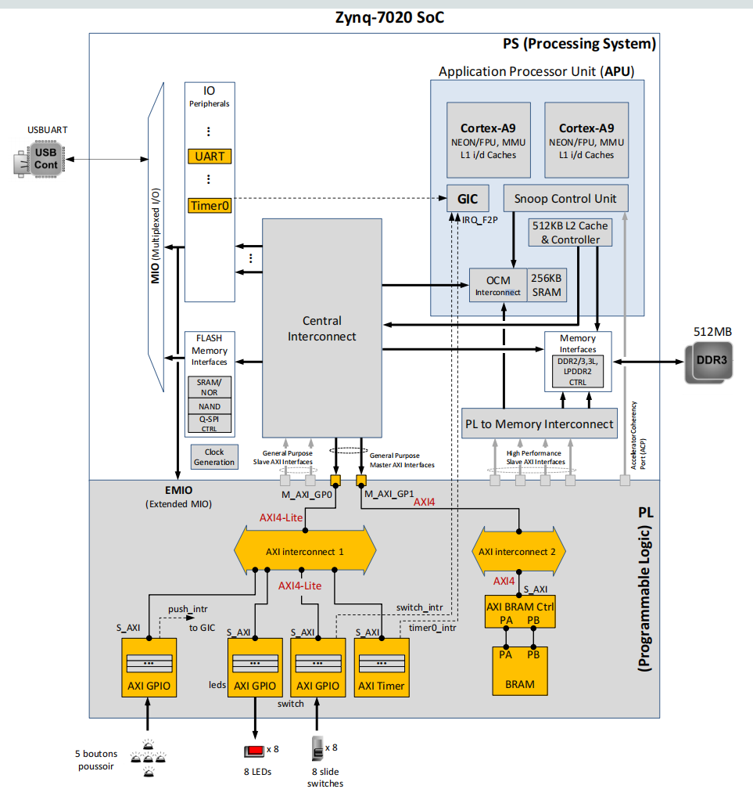

# 嵌入式面试问题分类汇总（整合版）

> **快速导航**：12 大类、112 道高频题
> **使用建议**：优先背“主回答”，再补 1–2 条追问；本版已将原 `嵌入式面试问题.md` 中的题型按主题合并到这一份总表里。

---

## 📌 分类速查表

| 分类 | 题数 | 核心知识点 |
|-----|-----|---------|
| [一、存储与启动](#storage-and-boot) | 5 | Flash、Bootloader、中断向量表 |
| [二、单片机基础](#mcu-basics) | 8 | GPIO、Timer、PWM、NVIC |
| [三、通信协议](#communication-protocols) | 7 | UART、I2C、SPI、CAN、I2S |
| [四、RTOS与并发](#rtos-and-concurrency) | 20 | 调度、优先级反转、信号量、互斥锁 |
| [五、C/C++语言](#c-and-cpp) | 15 | 指针、堆栈、struct、class、volatile |
| [六、嵌入式Linux](#embedded-linux) | 9 | 启动流程、进程线程、系统调用 |
| [七、网络编程](#network-programming) | 13 | TCP/UDP、socket、epoll、粘包 |
| [八、硬件设计](#hardware-design) | 8 | ADC、DMA、上拉下拉、低功耗 |
| [九、工程实践](#engineering-practice) | 8 | 交叉编译、HAL、OTA、内存对齐 |
| [十、实战高频](#high-frequency-scenarios) | 7 | 按键消抖、环形缓冲、故障排查 |
| [十一、系统认知与综合概念](#system-and-concepts) | 11 | RTOS 状态、硬实时、固件、FOC |
| [十二、Zynq-7020 架构与图中术语](#zynq-architecture) | 6 | PS/PL、APU、SCU、GIC、Cache、AXI、MIO/EMIO |

---

## 一、存储与启动（5题） { #storage-and-boot }

### 1. Flash Memory 是什么？

**主回答**
> Flash Memory（闪存）是非易失性存储器，断电不丢数据。常见两种：
> - **NOR Flash**：随机读快，可支持XIP（eXecute In Place）直接执行代码；写入前通常按扇区擦除
> - **NAND Flash**：容量大、单位容量成本低，按页读写、按块擦除；常用于SSD/eMMC，需考虑坏块与ECC纠错
> 
> 嵌入式中用于存储 Bootloader、应用程序、参数等。

**追问1**：NOR vs NAND 怎么选？  
**答**：需要直接执行代码/随机读多→NOR；大容量/顺序读写→NAND（配文件系统/坏块管理）。SSD用NAND。

**追问2**：Flash与RAM/ROM的区别？  
**答**：常见 DRAM、SRAM 属于易失性 RAM，掉电丢数据；掩膜 ROM 在制造时确定内容；Flash 属于可电擦写的非易失性存储器，但写入前常需按块擦除，写入速度和寿命不能按 RAM 理解。

**追问3**：DRAM、SRAM、EEPROM、MRAM 各有什么特点？\
**答**：DRAM 用电容存数据，易失、需定期刷新，容量大，常作主内存；SRAM 用触发器存数据，易失、无需刷新，速度快但成本高，常作缓存或 MCU 片上 RAM；EEPROM 非易失，可按字节或小粒度改写，常存少量配置参数；MRAM 用磁性状态存数据，非易失、写入快且耐写，适合频繁更新的数据，但成本较高。

#### 延伸学习：从存储单元理解六类存储器

**先建立分类坐标。** CPU 运行时要反复读写临时变量，而固件、配置和日志还要在断电后保留。于是先问两件事：断电是否保留数据？改写一个值需要付出什么代价？“随机访问”描述能否直接定位地址，**不等于**“断电不丢失”；“静态”描述 SRAM 不用定期刷新，**不等于**不需要供电。

```text
临时工作区（断电丢失）             长期保存（断电保留）
SRAM：小而快、无需刷新           NOR Flash：代码、随机读取
DRAM：大而便宜、需要刷新         NAND Flash：大容量数据
                                EEPROM：少量参数
                                MRAM：频繁更新的持久数据
```

| 类型 | 一个比特靠什么保存 | 掉电后 | 改写特点 | 典型位置 |
|------|-------------------|--------|----------|----------|
| DRAM（动态随机存取存储器） | 电容中的电荷 | 丢失 | 可直接读写，但要刷新 | DDR 主内存 |
| SRAM（静态随机存取存储器） | 交叉耦合晶体管构成的锁存状态 | 丢失 | 可直接读写，无需刷新 | CPU 缓存、MCU 片上 RAM |
| NOR Flash（或非型闪存） | 绝缘结构中保存的电荷 | 保留 | 可随机读；改写前通常擦除整个扇区 | 固件、启动代码 |
| NAND Flash（与非型闪存） | 绝缘结构中保存的电荷 | 保留 | 按页读/编程、按块擦除 | eMMC、SSD、文件数据 |
| EEPROM（电可擦可编程只读存储器） | 绝缘结构中保存的电荷 | 保留 | 通常可按字节或较小粒度改写；写入有寿命 | 设备参数、校准值 |
| MRAM（磁阻随机存取存储器） | 磁性层的相对方向 | 保留 | 可快速改写，通常无需先擦除整块 | 高频更新的关键状态 |

表中的“快、便宜、耐写”都是**同类器件的常见趋势**，不是跨接口、工艺、容量的固定排名。选型最终看具体芯片的数据手册：访问延迟、吞吐量、容量、供电、写入粒度、擦除粒度、耐久度和数据保持条件。

**为什么 DRAM 需要刷新，而 SRAM 不需要？** DRAM 常见存储单元是一个晶体管加一个电容（1T1C）。可先把电容想成小水杯：有电荷/少电荷代表两个逻辑状态；漏电会让差别逐渐变小，所以控制器要周期性地读取并恢复电荷。读 DRAM 时也会扰动单元电荷，需要恢复。电容和单个访问晶体管使单元面积较小，适合做大容量主内存。这里的“刷新”只在**持续供电**时维持数据，不能让 DRAM 变成非易失性存储器。

SRAM 常用交叉耦合反相器形成两个稳定状态，典型单元为六个晶体管（6T）。只要供电，电路会维持当前状态，因此不需要像 DRAM 那样周期性刷新；但单元占面积更大，通常容量较小、每比特成本较高。例子：MCU 中的任务栈和全局变量常放片上 SRAM；运行 Linux 的板子通常把内核和进程工作区放在外部 DDR DRAM。SRAM 的“不刷新”不能推出“低功耗模式一定保留数据”：若对应电源域被关闭，它仍会丢失。

**为什么 Flash 写入前常要擦除？** NOR 和 NAND 都利用被绝缘层隔离的电荷改变晶体管的阈值电压，读电路根据阈值判断数据。以常见 NOR 器件的逻辑表示为例，擦除后为 `1`，编程可把 `1` 变成 `0`，但要把 `0` 改回 `1`，必须擦除包含它的整个扇区。NAND 也有“先擦除、再编程”的约束，不过其基本组织通常是**页**读/编程、**块**擦除。具体页大小、擦除块大小以及是否允许部分页编程，必须查器件手册。

**一个改写例子。** 假设 NOR 的擦除扇区是 4 KiB，里面只想改 1 字节，且新值需要把某些位从 `0` 改为 `1`。不能直接对该字节执行一次编程：应先把整个扇区有效数据读到 RAM，修改目标字节，擦除扇区，再把数据写回并校验。生产系统还要考虑擦除/写入中途断电，可用双份记录、版本号、校验和等办法恢复。这也是为什么“能按字节寻址读取”不意味着“能按字节独立擦除”。

**NOR 和 NAND 的分工。** NOR 擅长随机读取，若芯片与总线支持内存映射，CPU 可原地取指执行（XIP）；但它不是天然等同于 RAM，写入仍有擦除约束。NAND 单位容量成本通常更低，适合大容量数据；其页/块组织和位错误使系统必须处理纠错码（ECC）、坏块、磨损均衡等问题。原始 NAND 的管理通常由主控承担；eMMC、UFS、SSD 等受管理设备把许多管理工作交给内部控制器。因此“NAND 不能存启动代码”也不对：不少系统把代码放 NAND，上电后由启动链读取到 RAM 执行。

**EEPROM 与 Flash 都能掉电保存，差别在改写粒度。** 常见串行 EEPROM 在接口上支持按字节或按页写少量参数，内部可能自动完成擦写；这使更新一个配置值比管理整个 Flash 擦除扇区更方便。但“接口上写一个字节”不代表内部没有擦写，也不代表可以无限次写。EEPROM 适合设备编号、校准参数、少量配置；若每秒记录大量日志，就应核算寿命并考虑磨损均衡或其他介质。

**MRAM 为什么能在掉电后保留数据？** 常见磁隧道结（MTJ）有参考磁性层和可切换磁性层；两层磁化方向平行或反平行时电阻不同，读电路由电阻区分比特。写入通过改变磁化方向完成，不依赖 Flash 那样的整块擦除。因此 MRAM 常用于需要快速、频繁更新并且断电保留的状态。不同 MRAM 技术和产品的写入方式、速度、容量、耐久度差异很大，不能把“MRAM 等于 SRAM 速度、无限寿命”当成通用保证。

**把六种器件放进同一个系统。** 一个带 Linux 的记录设备可能用 NOR 保存首级启动程序，用 NAND/eMMC 保存系统镜像与大量采样文件，用 DRAM 运行内核和应用；SoC 内部 SRAM 留给缓存或启动早期的小型工作区；EEPROM 保存板卡校准值；如果要求掉电瞬间仍保住频繁变化的计数器，可评估 MRAM。具体分配仍受 SoC 启动能力、接口和成本制约。

**耐久度算例。** 假设某 EEPROM 数据手册保证同一地址可擦写 100,000 次，程序每分钟更新该地址一次，那么理想化的使用时间是

\[
\frac{100000\ \text{次}}{60\ \text{次/小时}\times24\ \text{小时/天}}\approx69.4\ \text{天}
\]

这只是按单地址、固定写入频率计算的简化估算，不是器件可靠寿命承诺：温度、电压、写入模式和数据保持要求也会影响结果。若改为每小时写一次，同样计算约为 11.4 年；若频率不能降低，可轮换多个位置并设计掉电恢复机制。

---

### 2. Bootloader 是什么？

**主回答**
> Bootloader是上电后执行的第一段程序，流程：
> ```
> 上电 → CPU从固定地址取指 → Bootloader运行
> → 初始化时钟/DDR/串口/存储
> → 加载应用到RAM → 跳转执行应用
> ```
> 通常还带固件升级功能（串口/USB/OTA）。

**追问1**：升级如何防止变砖？  
**答**：双分区A/B切换、升级包CRC/签名校验、断点续传、回滚机制。

**追问2**：Bootloader占多少空间？  
**答**：一般16-128KB；大小取决于功能复杂度和硬件初始化量。

---

### 3. 裸机编程是什么？

**主回答**
> Bare Metal（裸机）是无操作系统，程序直接跑硬件上。
> - **结构**：`main()` → `while(1)` 主循环 + 中断
> - **优点**：简单、资源占用小、确定性强
> - **缺点**：复杂度上升难维护、多任务支持差

**追问1**：复杂逻辑怎么组织？  
**答**：有限状态机(FSM)、事件队列、定时器驱动任务切片；ISR只做"置标志/搬数据"，复杂处理放主循环。

**追问2**：什么时候用裸机，什么时候用RTOS？  
**答**：简单单任务、资源极限→裸机；多任务、实时要求高→RTOS。

---

### 4. GPIO / Timer / PWM 分别做什么？

**主回答**
> - **GPIO**：通用输入输出，按键/LED常见应用
> - **Timer**：计数/定时/捕获比较、触发中断、PWM基础
> - **PWM**：脉宽调制，通过占空比输出等效模拟量（电机/LED/舵机）

**追问1**：PWM频率和分辨率如何权衡？  
**答**：频率高→噪声小但分辨率可能下降；分辨率由计数范围决定。按负载选频率，尽量提高ARR/PSC范围。

**追问2**：舵机为何用50Hz？  
**答**：脉宽1-2ms映射角度，周期20ms（50Hz）是业界标准，便于同步控制。

---

### 5. 中断控制器（NVIC）是什么？

**主回答**
> NVIC（Nested Vectored Interrupt Controller）用于ARM Cortex-M系列：
> - **功能**：中断使能、优先级管理、向量跳转、中断嵌套
> - **抢占优先级 vs 响应优先级**：前者决定能否抢占，后者决定同级顺序

**追问1**：中断里能做复杂计算吗？  
**答**：不建议。ISR原则是短小快速，只做"读寄存器/清标志/置事件"，复杂处理放任务。

**追问2**：优先级怎么设置？  
**答**：硬实时事件高优先级，中断嵌套层数不超过3-4层避免栈爆炸。

---

## 二、单片机基础（8题） { #mcu-basics }

### 6. 单片机中断基本流程？

**主回答**
> ```
> 中断触发 → 保存现场(PC/LR/寄存器)
> → 进入ISR → 处理事件+清中断标志
> → 恢复现场 → 返回主程序
> ```
> ISR是被动触发，实时性最强。

**追问1**：ISR里最忌讳什么？  
**答**：长时间阻塞（printf、sleep、等锁），会破坏实时性。用信号量/队列通知任务处理。

**追问2**：中断嵌套和优先级反转关系？  
**答**：嵌套指中断被中断打断；优先级反转是低优先级任务阻塞高优先的情况（RTOS概念）。

---

### 7. 中断向量表是什么？

**主回答**
> 向量表保存各中断/异常入口地址，CPU根据中断号查表跳转ISR。
> - **位置**：Flash起始地址
> - **结构**：[MSP, Reset_Handler, NMI_Handler, HardFault_Handler, ...]

**追问1**：向量表能重定位吗？  
**答**：支持，通过VTOR（Vector Table Offset Register）；用于Bootloader/APP分区切换。

**追问2**：如何手动修改向量表？  
**答**：直接定义数组或使用编译器属性（`__attribute__`），指向各ISR函数。

---

### 8. 中断与轮询区别？

**主回答**
> - **轮询**：主循环不断检查状态，占用CPU、延迟高、浪费功耗
> - **中断**：事件驱动，效率高、响应快、适合实时场景
>
> 缺点：中断频繁可能导致系统不稳定。

**追问1**：什么时候反而用轮询？  
**答**：事件极频繁且处理时间短；启动自检读状态；避免中断抖动。

**追问2**：按键如何消抖？  
**答**：中断里只置标志，主循环/定时器延时10-20ms确认；或定时器100Hz采样滤波。

---

### 9. GPIO 开漏输出是什么？

**主回答**
> 开漏输出只能拉低不能主动拉高，需要外部上拉电阻形成高电平。
> - **优点**：可驱动多个输出线"线与"、支持不同电压
> - **应用**：I2C、IIC、故障诊断输出

**追问1**：为什么I2C要用开漏？  
**答**：多个从设备共享SDA/SCL，开漏实现"线与"逻辑，任意设备拉低就低。

**追问2**：上拉电阻多大合适？  
**答**：一般10kΩ，需平衡驱动能力与功耗；高速通信可用更小值。

---

### 10. ADC 关键指标有哪些？

**主回答**
> - **分辨率**：如12bit可表示4096个等级
> - **采样率**：每秒采样次数（kS/s或MS/s）
> - **精度**：转换结果误差
> - **通道数**：可接传感器个数
> - **转换时间**：单次转换耗时

**追问1**：怎么提高测量精度？  
**答**：增加采样次数求平均、硬件配RC滤波、校准偏移和增益系数。

---

### 11. DMA 是什么？

**主回答**
> DMA（Direct Memory Access）在外设和内存间直接传输数据，无需CPU参与。
> - **优点**：CPU负担小、传输快、功耗低
> - **应用**：ADC连续采样、UART大数据接收、Flash编程

**追问1**：DMA+中断怎么组织？  
**答**：外设触发DMA搬数据到buffer，DMA完成/半满时中断通知，ISR只发信号给任务处理。

---

### 12. 看门狗定时器（Watchdog）怎么用？

**主回答**
> 看门狗是防死机装置：倒计时定时器，程序需定期"喂狗"（重载计数器），否则复位系统。
> - **适用场景**：长时间运行不能人工复位的设备
> - **喂狗周期**：通常设为超时时间的1/3到1/2

**追问1**：喂狗周期多少合理？  
**答**：若看门狗设1秒，喂狗周期应<500ms，留出余量防止误触发。

---

### 13. 低功耗模式有哪些？

**主回答**
> - **Sleep**：CPU停止，外设继续，唤醒快
> - **Stop**：大部分时钟关闭，功耗更低，外设可保留
> - **Standby**：几乎全关，只保留最小唤醒电路，功耗最低

**追问1**：什么时候选哪种模式？  
**答**：短暂空闲→Sleep；长时间空闲/低功耗设备→Stop/Standby；按实际休眠时间权衡唤醒延迟。

---

## 三、通信协议（7题） { #communication-protocols }

### 14. UART 是什么？

**主回答**
> UART（Universal Asynchronous Receiver/Transmitter）异步串口通信：
> - **线**：TX、RX（有时+RTS/CTS硬件流控）
> - **特点**：简单、低速、常用于调试和GPS
> - **波特率**：常见9600/115200，MCU需和外设一致

**追问1**：如何支持硬件流控？  
**答**：添加RTS/CTS线；发送方可根据CTS拉低/拉高调整发送速率。

**追问2**：串口收包不丢数据怎么做？  
**答**：用中断或DMA+环形缓冲，按帧头/长度/校验解析；ISR不做重逻辑。

---

### 15. I2C 原理与特点？

**主回答**
> I2C（Inter-Integrated Circuit）两线同步总线：
> - **线**：SCL（时钟）、SDA（数据），开漏输出需上拉
> - **特点**：多主多从、软件灵活、集成简单
> - **速率**：100kHz（标准）、400kHz（快速）、1MHz（高速）

**追问1**：I2C为什么要上拉电阻？  
**答**：开漏输出，上拉到高电平；多设备线与共享。

**追问2**：同步和异步区别？  
**答**：同步有时钟信号同步（SPI/I2C）；异步依赖波特率计时（UART）。

---

### 16. SPI 全双工通信？

**主回答**
> SPI（Serial Peripheral Interface）高速同步全双工：
> - **线**：SCLK（时钟）、MOSI（主→从）、MISO（从→主）、CS（片选）
> - **特点**：速度快、协议简单、支持全双工
> - **应用**：Flash、显示屏、高速ADC

**追问1**：为什么需要CS片选？  
**答**：总线可挂多个从设备，CS选择目标并界定传输边界。

**追问2**：多从设备怎么接？  
**答**：每从一条CS线；MOSI/MISO/SCLK并联；主机按序拉低对应CS通信。
Chip Select，片选信号，用于选择SPI总线上的从设备。
---

### 17. CAN 总线优势？
的地位
**主回答**
> CAN（Controller Area Network）多主差分高可靠总线：
> - **特点**：自仲裁、抗干扰强、错误检测、广泛用于汽车/工业
> - **速率**：常见500kbps、1Mbps
> - **帧**：标准帧(11位ID)、扩展帧(29位ID)

**追问1**：ID低优先级高怎么理解？  
**答**：仲裁时ID小的优先级高；同时发送时ID小的赢得总线。

**追问2**：CAN错误如何处理？  
**答**：错误主动/被动模式、自动重传、帧检验校验。

---

### 18. I2S 用于什么？

**主回答**
> I2S（Inter-IC Sound）音频数据传输协议：
> - **线**：BCLK（位时钟）、LRCLK（声道时钟）、SD（数据）
> - **应用**：连接音频Codec、DAC/ADC
> - **格式**：Philips I2S、Left-Justified、Right-Justified

**追问1**：为什么需要LRCLK？  
**答**：区分左右声道，LRCLK决定数据属于哪个声道。

---

### 19. 传感器通信协议怎么描述？

**主回答模板**
> 我从四点说：
> 1. **协议**：SPI/I2C/UART/CAN
> 2. **速率**：如I2C 400kHz、SPI 8MHz、UART 115200
> 3. **帧格式**：帧头+ID+长度+负载+校验(CRC)
> 4. **可靠性**：超时重传、环形缓冲、DMA、中断策略

**追问1**：数据偶尔错误怎么办？  
**答**：加CRC校验、超时重传、软件滤波去毛刺；检查硬件：线长、上拉、终端电阻。

---

### 20. PWM 在哪些场景用？

**主回答**
> - **电机调速**：占空比→速度
> - **LED调光**：占空比→亮度
> - **舵机控制**：脉宽→角度（通常50Hz, 1-2ms）
> - **蜂鸣器**：频率→音调

**追问1**：多组PWM同步如何实现？  
**答**：同一定时器多通道或软件同步机制。

---

## 四、RTOS与并发（20题） { #rtos-and-concurrency }

### 21. RTOS vs 裸机？

**主回答**
> - **裸机**：while(1)+中断，简单但难维护、多任务支持差
> - **RTOS**：多任务、优先级调度、同步互斥、可维护强但资源占用大
>
> 选择：简单→裸机；复杂实时→RTOS

**追问**：RTOS和Windows/Linux根本区别？  
**答**：RTOS保证实时性（任务必须deadline前完成）；通用OS只尽量快。

---

### 22. RTOS 调度器怎么工作？

**主回答**
> 调度器按优先级从就绪队列选择最高优先级任务执行：
> - **抢占式**：高优先级可打断低优先级（实时性好）
> - **协作式**：任务主动让出CPU（简单但实时性弱）
>
> 任务状态：Running → Ready → Blocked → Suspended

**追问1**：如何避免优先级反转？  
**答**：优先级继承或天花板机制。

**追问2**：定时器中断也通过调度吗？  
**答**：定时器中断触发调度器重新选择就绪任务。

---

### 23. 优先级反转是什么？

**主回答**
> 低优先级任务持有资源，高优先级任务等待，中优先级又一直运行，导致高优先被拖延。
> 
> **解决**：优先级继承（低优先临时继承高优先级直到释放资源）或优先级天花板。

**追问**：如何检测优先级反转？  
**答**：通过日志/trace分析任务调度顺序，观察高优先任务被延迟时长超预期。

---

### 24. 任务间通信方式？

**主回答**
> - **消息队列**：任意数据传递
> - **信号量**：事件同步、资源计数
> - **互斥锁**：保护共享资源
> - **事件标志组**：多事件组合同步
> - **条件变量**：线程等待条件

**追问**：哪个用于生产者-消费者？  
**答**：消息队列最直接；或信号量+手动缓冲。

---

### 25. 互斥锁 vs 信号量？

**主回答**
> - **Mutex**：互斥，有"所有权"概念，通常初值1，进入临界区lock，离开unlock
> - **Semaphore**：计数，用于资源控制或事件通知，初值可为N
>
> 用途：保护共享变量→Mutex；事件同步→Semaphore；资源池→Semaphore

**追问**：Mutex死锁怎么避免？  
**答**：固定加锁顺序、超时机制、trylock。

---

### 26. 任务栈管理要注意什么？

**主回答**
> - **栈大小**：按局部变量+调用深度估计，留余量
> - **栈溢出检测**：FreeRTOS有uxTaskGetStackHighWaterMark()
> - **栈初值**：通常填0xA5或0xCC便于识别
> - **位置**：通常在SRAM末尾

**追问**：栈溢出有什么后果？  
**答**：覆盖其他数据、系统崩溃、难以定位的bug。

---

### 27. FreeRTOS 核心概念？

**主回答**
> - **Task**：独立执行流，有栈、优先级、状态
> - **Scheduler**：根据优先级调度就绪任务
> - **Tick**：系统时钟中断，通常1ms一次
> - **Context Switch**：任务切换，保存/恢复上下文

**追问**：怎么检测任务CPU占用率？  
**答**：FreeRTOS可配置运行时统计，定时器中断计累计运行时间。

---

### 28. 中断嵌套和优先级？

**主回答**
> - **中断嵌套**：高优先级中断打断低优先级ISR执行
> - **避免过度嵌套**：设置合理优先级分层、控制ISR时长
> - **系统稳定**：通常不超过3-4层嵌套

**追问**：ISR里能调用FreeRTOS API吗？  
**答**：只能调用带"FromISR"后缀的函数（如xQueueSendFromISR）。

---

### 29. 死锁原因与避免？

**主回答**
> **四个必要条件**（破坏任一可避免）：
> 1. 互斥：资源独占
> 2. 占有且等待：持有锁再等新锁
> 3. 不可剥夺：无法强制释放
> 4. 循环等待：任务循环等待
>
> **避免**：固定加锁顺序、超时、trylock、拆分粒度

**追问**：哪个条件最好破坏？  
**答**：循环等待和占有且等待最实际；通过顺序和timout可同时破坏两个。

---

### 30. 信号量二值 vs 计数？

**主回答**
> - **二值信号量**：初值1，只能0/1，用于互斥或简单事件
> - **计数信号量**：初值N，用于资源池或多个事件累计

**追问**：资源池怎么用信号量？  
**答**：初值=资源数，获取时-1，释放时+1；0时等待表示资源耗尽。

---

### 31. 条件变量适用什么场景？

**主回答**
> 生产者-消费者模式：消费者等待条件（队列非空），生产者发送信号唤醒。
> - **优点**：避免忙等或轮询
> - **配套**：通常和Mutex搭配

**追问**：Condition Variable vs Semaphore用哪个？  
**答**：CV更灵活但复杂；Semaphore简单直接，多数场景够用。

---

### 32. 消息队列原理？

**主回答**
> 环形缓冲结构，生产者写入消息，消费者读取：
> - 满时生产者可阻塞或返回，空时消费者阻塞等待
> - 通常用于任务间数据传递和事件通知

**追问**：队列溢出怎么处理？  
**答**：可选覆盖旧数据、阻塞发送方、丢弃新数据。

---

### 33. Linux 进程vs线程？

**主回答**
> - **进程**：资源分配单位，独立地址空间，切换开销大
> - **线程**：调度单位，共享地址空间，切换快但需同步
>
> 安全性：进程隔离强；线程共享内存需谨慎。

**追问**：什么时候用进程？  
**答**：需要隔离、互不影响→进程；任务分工明确但资源共享→线程。

---

### 34. 线程同步工具？

**主回答**
> - **Mutex**：互斥锁，保护临界区
> - **Condition Variable**：条件等待
> - **Semaphore**：计数同步
> - **RWLock**：读写锁，多读单写
> - **Barrier**：同步栅栏

**追问**：读写锁什么时候用？  
**答**：读频繁写稀少，多个读者并行不冲突。

---

### 35. 死锁检测与恢复？

**主回答**
> - **检测**：系统记录资源分配图，检测环路
> - **恢复**：终止部分进程、强制释放资源
>
> 实际多采用**预防**（银行家算法、资源有序分配）而非检测恢复。

---

## 五、C/C++语言（15题） { #c-and-cpp }

### 36. 指针和数组区别？

**主回答**
> - **指针**：变量存储地址，可改指向、可为空、sizeof=指针大小
> - **数组**：连续内存块，固定大小、数组名不可改、sizeof=整体大小
>
> 数组名在表达式中退化为指针，但本质不同。

**追问1**：函数参数里数组会退化吗？  
**答**：会退化为指针，因此sizeof(arr)在函数里得指针大小，需另传数组长度。

**追问2**：函数指针怎么用？  
**答**：`int (*func_ptr)(int, int) = &add;`用于回调函数、驱动接口。

---

### 37. const 和 volatile？

**主回答**
> - **const**：编译期只读，放Flash节省RAM
> - **volatile**：禁优化，每次都从内存读写；用于硬件寄存器、中断变量、多线程
>
> 两者可组合：`const volatile int reg = ...;`

**追问1**：const int *p vs int * const p？  
**答**：前者数据不可改；后者指针不可改。

**追问2**：为什么中断变量要volatile？  
**答**：中断改变变量，编译器可能优化掉读写导致看不到最新值。

---

### 38. 堆和栈区别？

**主回答**
> | 属性 | 栈 | 堆 |
> |------|-----|------|
> | 管理 | 自动 | 手动malloc/free |
> | 大小 | 小（KB） | 大（MB） |
> | 速度 | 快 | 慢 |
> | 易失性 | 函数返回失效 | 手动释放 |
> | 风险 | 溢出崩溃 | 泄漏、碎片 |
>
> 嵌入式优先用栈，避免malloc。

**追问**：栈溢出症状？  
**答**：覆盖其他变量、异常跳转、系统崩溃。

---

### 39. 内存泄漏怎么检测？

**主回答**
> - **静态分析**：代码审查找malloc无对应free
> - **运行时工具**：valgrind、asan(Address Sanitizer)
> - **嵌入式方案**：内存池统计、日志追踪
>
> 预防：尽量用栈/静态、RAII模式(C++)、内存池。

**追问**：为什么嵌入式不推荐malloc？  
**答**：碎片化、实时性不确定、资源紧张、不利于功耗管理。

---

### 40. 位操作常用技巧？

**主回答**
> ```c
> // 置第n位为1
> x |= (1 << n);
> 
> // 清第n位
> x &= ~(1 << n);
> 
> // 翻转第n位
> x ^= (1 << n);
> 
> // 检查第n位
> if (x & (1 << n)) { ... }
> ```

**追问**：如何一次设置多位？  
**答**：`x |= 0b1111000;` 或 `x |= (0xF << 4);`

---

### 41. 大端小端？

**主回答**
> - **大端(Big Endian)**：低地址存高字节，网络字节序
> - **小端(Little Endian)**：低地址存低字节，大多数MCU/PC
>
> STM32小端；网络通信需htonl/ntohl转换。

**追问**：怎么判断机器字节序？  
**答**：
> ```c
> int x = 0x12345678;
> if (*(char*)&x == 0x78) printf("小端\n");
> ```

---

### 42. 结构体对齐与padding？

**主回答**
> 编译器自动插入填充字节对齐，提高访问效率。
> ```c
> struct Foo {
>   char a;    // offset 0
>   // 3字节填充
>   int b;     // offset 4
>   char c;    // offset 8
>   // 7字节填充
> }; // sizeof = 16字节
> ```
> 
> 通信需要：`#pragma pack(1)` 或 `__attribute__((packed))`

**追问**：union节省内存吗？  
**答**：是，成员共用内存，大小=最大成员；用于协议解析。

---

### 43. C 和 C++ 在嵌入式选哪个？

**主回答**
> - **C**：贴近硬件、代码紧凑、生态成熟、驱动首选
> - **C++**：OOP、模板、可维护好、业务复杂推荐
>
> 实际：底层驱动用C，应用逻辑用C++；要控制异常、RTTI、STL开销。

**追问**：虚函数开销大吗？  
**答**：有虚表查询开销，但相对可控；关键路径避免或确保频率不极高。

---

### 44. 宏 vs inline函数？

**主回答**
> - **宏**：预处理文本替换，无类型检查，可能有副作用
> - **inline**：编译期内联，有类型检查，更安全
>
> 用宏做常量、条件编译；函数逻辑用inline。

**追问**：宏怎么写才安全？  
**答**：参数加括号、整体加括号、避免副作用。

---

### 45. strcpy 溢出防护？

**主回答**
> ```c
> // 不安全
> strcpy(dest, src);
> 
> // 安全版本
> strncpy(dest, src, sizeof(dest)-1);
> dest[sizeof(dest)-1] = '\0';
> ```
> 或用strlcpy（若可用）、或手动计算长度。

**追问**：为什么要-1？  
**答**：预留\0位置，确保字符串正常结尾。

---

### 46. 递归注意事项？

**主回答**
> - **必须有终止条件**，否则无限递归
> - **栈消耗**：每次调用压栈，嵌入式栈小要谨慎
> - **替代方案**：循环+显式栈/队列
>
> 递归深度通常<10为安全。

**追问**：怎样用迭代替代递归？  
**答**：斐波那契、树遍历等可用显式栈DFS替代。

---

### 47. 命名空间和static？

**主回答**
> - **namespace**：组织符号、防冲突（C++）
> - **static**：文件作用域（C）或类成员（C++）
> - **外部链接**：全局符号其他文件可见
> - **内部链接**：static限制本文件

**追问**：为什么头文件不写using namespace std?  
**答**：会污染全局命名空间，导致冲突。

---

### 48. 类的封装和继承？

**主回答**
> - **封装**：private/public/protected隐藏实现
> - **继承**：代码复用、多态基础
> - **多态**：虚函数实现运行时多态
>
> 嵌入式尽量用组合而非深继承。

**追问**：虚函数表怎么工作？  
**答**：每个类有虚表指针，指向虚函数地址数组；调用时动态查表跳转。

---

### 49. 模板和泛型？

**主回答**
> 模板在编译期实例化生成具体代码，适合容器/算法库。
> 
> 缺点：编译复杂、二进制膨胀；嵌入式谨慎用。

**追问**：模板代码会膨胀吗？  
**答**：会，每个类型实例化一份代码。控制模板层数和实例数。

---

### 50. 异常处理开销？

**主回答**
> C++异常有性能开销（栈展开、类型识别）。
> 
> 嵌入式典型做法：
> - 关闭异常（-fno-exceptions）
> - 用返回值/错误码而非throw
> - 关键路径避免异常

---

## 六、嵌入式Linux（9题） { #embedded-linux }

### 51. Linux 启动流程？

**主回答**
> ```
> 1. Bootloader(U-Boot)
>    ├─ 初始化硬件、时钟、DDR
>    └─ 加载内核到内存
> 
> 2. Kernel启动
>    ├─ 初始化MMU、内存管理
>    ├─ 加载设备驱动
>    └─ 启动第一个用户进程init
> 
> 3. Init进程
>    ├─ 挂载文件系统
>    ├─ 启动系统服务
>    └─ 系统进入正常运行
> ```

**追问**：Kernel代替Bootloader跳转吗？  
**答**：是；Bootloader加载kernel到RAM，然后跳转到kernel_entry。

---

### 52. 进程 vs 线程详解？

**主回答**
> | 比较 | 进程 | 线程 |
> |-----|-----|------|
> | **地址空间** | 独立 | 共享 |
> | **切换开销** | 大 | 小 |
> | **隔离** | 强 | 弱 |
> | **创建速度** | 慢 | 快 |
> | **通信** | IPC复杂 | 直接共享内存 |

**追问**：什么时候多进程比多线程好？  
**答**：需要强隔离与独立性；一个进程奔溃不影响其他。

---

### 53. IPC 通信方式（进程间）？

**主回答**
> - **管道**：单向、简单、用于parent-child
> - **消息队列**：有结构、可多进程
> - **共享内存**：最快、需同步机制
> - **信号量**：计数同步
> - **Socket**：网络通信、本地IPC
> - **信号**：异步通知

**追问**：管道怎么实现双向通信？  
**答**：两条管道，或全双工socket。

---

### 54. 系统调用是什么？

**主回答**
> 用户进程请求内核服务的接口，从用户态切到内核态：
> ```
> 用户程序 → system call(触发中断/陷入)
> → 内核处理 → 返回用户态
> ```
> 
> 常见：open/read/write/fork/exec/socket等。

**追问**：用户态和内核态为什么分离？  
**答**：隔离与安全，防止用户程序破坏系统。

---

### 55. Linux 常用命令？

**主回答**
> **进程**：ps/top/kill/pgrep  
> **网络**：ping/ip/ss/netstat/tcpdump  
> **文件**：ls/cd/sed/grep/find/awk  
> **性能**：free/df/iostat/vmstat  
> **日志**：dmesg/journalctl/tail/less

**追问**：怎么看某端口占用？  
**答**：`ss -lntp | grep :端口号` 或 `netstat -lntp`。

---

### 56. TCP 三次握手和四次挥手？

**主回答**
> **三次握手**：SYN → SYN+ACK → ACK，建立连接  
> **四次挥手**：FIN → ACK → FIN → ACK，关闭连接
> 
> 挥手四次因为TCP全双工，双方各关闭发送方向。

**追问**：TIME_WAIT持续多久？  
**答**：2MSL（Maximum Segment Lifetime），防止旧报文影响新连接。

---

### 57. select/poll/epoll 区别？

**主回答**
> - **select**：轮询所有fd，<=1024个，O(n)
> - **poll**：不限fd数，仍O(n)轮询
> - **epoll**：事件驱动，O(1)查询，适合高并发
>
> 连接少用select/poll；连接多用epoll。

**追问**：epoll的LT和ET？  
**答**：LT(水平)持续通知有数据；ET(边沿)只通知状态变化边界。

---

### 58. 非阻塞IO和Reactor模型？

**主回答**
> 非阻塞：立刻返回，没数据返回EAGAIN  
> 配合epoll形成Reactor模式：
> ```
> Main loop:
>   events = epoll_wait(...)
>   for each event:
>     if readable: read_callback()
>     if writable: write_callback()
> ```

**追问**：什么时候用Reactor vs Proactor？  
**答**：Reactor事件通知就绪，应用读写；Proactor操作系统代为读写。Linux多Reactor。

---

### 59. 网络字节序转换？

**主回答**
> 网络字节序通常大端。转换函数：
> - `htonl/htons`：主机→网络(32/16位)
> - `ntohl/ntohs`：网络→主机
>
> STM32小端，网络通信要转。

**追问**：怎样写字节序无关的代码？  
**答**：收数据时用转换函数，或自己定义bswap_32等。

---

## 七、网络编程（13题） { #network-programming }

### 60. TCP 服务器五步建立？

**主回答**
> ```c
> 1. socket()     // 创建套接字
> 2. bind()       // 绑定IP+端口
> 3. listen()     // 进入监听
> 4. accept()     // 接收连接，返回已连接socket
> 5. recv/send()  // 收发数据，close()关闭
> ```

**追问1**：listen和accept区别？  
**答**：listen把socket变监听态；accept从监听队列取连接，返回新socket专供该客户端。

**追问2**：并发服务器怎么做？  
**答**：多进程/多线程处理每个连接，或epoll事件驱动。

---

### 61. TCP vs UDP 选择？

**主回答**
> | 特性 | TCP | UDP |
> |-----|-----|-----|
> | 连接 | 虚连接 | 无连接 |
> | 可靠 | 有重传 | 不保证 |
> | 速度 | 较慢 | 快 |
> | 适用 | 数据完整优先 | 实时延迟优先 |
>
> 实时音视频/IoT→UDP；文件传输/邮件→TCP。

**追问**：UDP怎么保证可靠？  
**答**：应用层加序号、ACK、重传、超时判定。

---

### 62. TCP 粘包/拆包？

**主回答**
> TCP无消息边界，多次send可能被合并或拆分。
> 
> 解决方案：
> 1. **固定长度**：每帧固定大小
> 2. **分隔符**：帧尾加特殊字符
> 3. **长度字段(推荐)**：Header | Length | Payload | CRC

**追问**：UDP会粘包吗？  
**答**：不会，UDP保留报文边界；但可能丢包、乱序。

---

### 63. Socket 连接建立过程？

**主回答**
> 客户端：
> ```c
> socket() → connect()  // SYN
>           ← SYN+ACK
>           → ACK
> ```
> 服务器accept()返回，获得已连接socket。

**追问**：connect超时多久？  
**答**：通常75秒或系统默认；可用setsockopt设SO_RCVTIMEO/SO_SNDTIMEO。

---

### 64. Socket 地址结构？

**主回答**
> ```c
> struct sockaddr_in {
>   sa_family_t sin_family;    // AF_INET
>   uint16_t sin_port;         // 端口(网络字节序)
>   struct in_addr sin_addr;   // IP
>   char sin_zero[8];          // 填充
> };
> ```

**追问**：为什么要填充？  
**答**：和struct sockaddr保持大小一致。

---

### 65. Listen 的 backlog 参数？

**主回答**
> backlog表示监听队列长度，超过客户端连接被拒绝。
> 
> 实际队列长度 = min(backlog, /proc/sys/net/core/somaxconn)

**追问**：连接过多导什么问题？  
**答**：新连接被拒绝、客户端收RST。

---

### 66. TCP KeepAlive 机制？

**主回答**
> 长连接空闲时定期发送心跳，检测连接是否断开：
> - SO_KEEPALIVE套接字选项启用
> - TCP_KEEPIDLE/INTVL/CNT调整参数

**追问**：应用层心跳和TCP KeepAlive怎么选？  
**答**：KeepAlive更底层通用；应用层心跳更可控，可附带业务数据。

---

### 67. UDP 服务器？

**主回答**
> ```c
> 1. socket(AF_INET, SOCK_DGRAM)
> 2. bind()
> 3. recvfrom()  // 接收数据包+源地址
> 4. sendto()    // 发送到源地址
> 无需listen/accept
> ```

**追问**：怎么给UDP加可靠性？  
**答**：应用层序号确认、超时重传、丢包检测。

---

### 68. Epoll 高效的原因？

**主回答**
> - **基于事件**：内核通知就绪fd，不用轮询所有fd
> - **红黑树管理**：高效查询和删除
> - **就绪列表**：O(1)获取就绪事件
> - **mmap**：内核缓冲区和用户空间共享，无拷贝

**追问**：EPollET怎么用？  
**答**：必须非阻塞且一次读空/写尽，避免遗漏事件。

---

### 69. 阻塞、非阻塞、异步的区别？

**主回答**
> - **阻塞**：调用不返回直到操作完成
> - **非阻塞**：立刻返回，通常需轮询或事件通知
> - **异步**：发起后立刻返回，通过回调/信号/事件通知结果
>
> select/epoll属非阻塞+事件驱动；aio属异步。

**追问**：Linux用异步IO吗？  
**答**：libaio可用，但复杂；多数用epoll非阻塞。

---

### 70. Socket 超时和错误处理？

**主回答**
> ```c
> // 设置接收超时
> struct timeval tv;
> tv.tv_sec = 5;
> setsockopt(sock, SOL_SOCKET, SO_RCVTIMEO, &tv, sizeof(tv));
> 
> // 检查错误
> if (recv(...) < 0) {
>   if (errno == EAGAIN) {
>     // 超时
>   } else {
>     // 其他错误
>   }
> }
> ```

**追问**：连接中断怎么快速检测？  
**答**：send返回-1 EPIPE；或用select、SO_KEEPALIVE。

---

### 71. 控制连接 vs 数据连接（FTP）？

**主回答**
> FTP有两条连接：
> - **控制连接**：端口21，传命令
> - **数据连接**：端口20(被动模式其他)，传文件
>
> 主动/被动模式：谁发起数据连接。

**追问**：为什么要分离？  
**答**：控制继续发命令，数据独立传输更灵活。

---

### 72. HTTP Keep-Alive ?

**主回答**
> HTTP/1.0 默认每请求一个连接、HTTP/1.1 默认Keep-Alive复用连接
> 
> 优势：减少连接建立开销、服务器资源利用率更高

**追问**：什么时候关闭连接？  
**答**：超时、客户端/服务器显式关闭、连接数限制。

---

## 八、硬件设计（8题） { #hardware-design }

### 73. PCB 设计基础？

**主回答**
> - **布线**：关键信号单独布线、避免过孔干扰
> - **地和电源**：大面积铺地、电源多点供电
> - **阻抗控制**：高速信号设计特征阻抗
> - **信号完整性**：端接电阻、过孔最小化、串终或并终

**追问**：什么时候用串终传电阻？  
**答**：发送端速率高、传输线长、源阻抗低；并终配50Ω。

---

### 74. 上拉下拉电阻作用？

**主回答**
> - **上拉**：拉到VCC，默认高电平，常用于按键/I2C
> - **下拉**：拉到GND，默认低电平
> - **作用**：避免引脚悬空、支持线与逻辑
>
> 电阻值通常10k，高速可更小。

**追问**：开漏为什么要上拉？  
**答**：开漏输出无法主动拉高，上拉电阻和外部设备"线与"实现共享。

---

### 75. 调试工具：万用表、示波器、逻辑分析仪？

**主回答**
> - **万用表**：测电压/电流/电阻，DC/AC
> - **示波器**：观察波形，触发捕获、FFT频谱分析
> - **逻辑分析仪**：数字信号捕获，协议解析(SPI/I2C/UART)
>
> 配合使用定位硬件问题。

**追问**：逻辑分析仪能测模拟信号吗？  
**答**：不能，只捕获高低电平；示波器能看波形。

---

### 76. 电源设计：LDO vs DCDC？

**主回答**
> - **LDO**：简单、低纹波、効率低(输入-输出压差损耗)、用于辅助电源
> - **DCDC**：高效、发热小、电磁干扰、用于主电源
>
> 一般DCDC+LDO级联。

**追问**：怎么选LDO参数？  
**答**：输入输出电压、最大电流、纹波要求、静态功耗。

---

### 77. EMI/EMC 设计？

**主回答**
> EMI(电磁干扰)/EMC(电磁兼容)：
> - **抑制源**：滤波、隔离、屏蔽
> - **加强抗扰度**：绕线、磁珠、TVS保护、地平面
> - **规范**：CE/FCC认证标准

**追问**：磁珠作用？  
**答**：高频滤波，阻抗随频率变化，隔离数字/模拟部分。

---

### 78. 晶体振荡器选择？

**主回答**
> - **频率精度**：±ppm级，越小越准
> - **频率范围**：MCU工作频率需匹配
> - **负载容量**：电容选择需配匹
> - **温漂**：极限温度范围偏差
>
> 通常8MHz或24MHz。

**追问**：晶体连接电容多大？  
**答**：通常10-50pF，根据晶体负载容量标注。

---

### 79. 防护电路：TVS、齐纳二极管？

**主回答**
> - **TVS**：快速响应瞬间浪涌，两端保护
> - **齐纳**：恒压稳压，单向
> - **TVS常用于**：GPIO、通信口、电源输入
>
> 选择参数：反向待机电压、浪涌电流。

**追问**：ESD防护怎么做？  
**答**：ESD二极管/芯片、布线避免长走线、大面积地。

---

### 80. 热管理：散热、降频、休眠？

**主回答**
> - **散热**：散热片、风扇、空间设计
> - **降频**：温度高time base降频减热
> - **休眠**：长期不用切低功耗模式
> - **监测**：温度传感器告警

**追问**：MCU温度如何监测？  
**答**：内部温度传感器ADC采集，或外部NTC热敏电阻。

---

## 九、工程实践（8题） { #engineering-practice }

### 81. 交叉编译是什么？

**主回答**
> 在一种平台上编译代码，在另一种架构平台运行。
> 
> 例如：PC(x86) × arm-none-eabi-gcc → 编译 → STM32(ARM)运行
> 
> 需要交叉编译工具链、库、头文件。

**追问**：怎么配置工程？  
**答**：CMake/Makefile指定-march、-mthumb；或使用嵌入式IDE自动配置。

---

### 82. HAL层设计目的？

**主回答**
> Hardware Abstraction Layer 屏蔽硬件差异：
> - 应用不直接操作寄存器，调用统一接口
> - 换芯片：只修改HAL，上层代码不变
> - 分工清晰：驱动开发者维护HAL，应用开发者调用
>
> 例：GPIO初始化统一为gpio_init(pin, direction)。

**追问**：HAL代码怎么组织？  
**答**：hal/gpio.h、hal/uart.h等接口；platform/stm32/gpio.c等实现。

---

### 83. OTA升级工程方案？

**主回答**
> ```
> 新固件下载 → Flash备用区写入
>          ↓
>          校验(CRC/SHA)成功?
>          ↓YES      ↓NO回滚
>          更新启动标志位    保持旧版本
>          下次上电: 新程序启动
> ```
> 
> 双分区/三分区策略保证可靠性。

**追问**：升级中掉电怎么办？  
**答**：校验失败自动回滚到旧版本，或断点续传重新升级。

---

### 84. 内存对齐和padding？

**主回答**
> 数据按特定字节边界存储，提高CPU访问效率。
> ```c
> struct X {
>   char a;      // offset 0, 1字节
>   // padding 3字节(4字节对齐align)
>   int b;       // offset 4
> }; // total 8字节
> ```
> 
> 通信/协议需消除padding：`#pragma pack(1)`。

**追问**：大对象怎么省内存？  
**答**：重排成员（大在前小在后）、压包、或union共用。

---

### 85. 编译优化选项？

**主回答**
> - `-O0`：不优化，调试友好
> - `-O1/O2/O3`：优化级别递增，编译时间变长
> - `-Os`：优化大小，嵌入式常用
> - `-Ofast`：忽略IEEE浮点标准，速度最快
>
> 通常发布用-O2或-Os。

**追问**：-O会影响调试吗？  
**答**：会，变量优化掉、指令顺序改变；调试版用-O0。

---

### 86. 链接脚本（Linker Script）？

**主回答**
> 链接脚本定义程序内存布局：
> ```
> MEMORY {
>   FLASH (rx)  : ORIGIN = 0x08000000, LENGTH = 256K
>   RAM (rwx)   : ORIGIN = 0x20000000, LENGTH = 64K
> }
> 
> SECTIONS {
>   .text : { *(.text*) } > FLASH
>   .data : { *(.data*) } > RAM AT > FLASH
> }
> ```

**追问**：怎样把代码放到指定地址？  
**答**：`__attribute__((section(".custom_section")))` + 链接脚本映射。

---

### 87. GDB调试技巧？

**主回答**
> ```
> arm-none-eabi-gdb app.elf
> (gdb) target remote :3333   // 连JTAG/SWD调试器
> (gdb) load                   // 烧写程序
> (gdb) break main             // 设断点
> (gdb) continue/next/step     // 执行
> (gdb) print var              // 查变量
> (gdb) backtrace              // 看堆栈
> ```

**追问**：怎么远程调试？  
**答**：OpenOCD开调试服务器，gdb通过网络连接。

---

### 88. 性能分析和优化？

**主回答**
> - **代码覆盖率**：哪些分支未测到
> - **执行时间分析**：gprof、perf找热点
> - **内存占用**：nm、size工具查符号大小
> - **功耗分析**：示波器测电坏功耗、模型计算
>
> 按优先级优化热点代码。

**追问**：怎么减少代码体积？  
**答**：-Os优化、干掉未用函数(--gc-sections)、压缩数据、STL谨慎用。

---

## 十、实战高频场景（7题） { #high-frequency-scenarios }

### 89. 按键消抖实现？

**主回答**
> ```c
> // 方案一：延时确认
> if (KEY_DOWN) {
>   delay_ms(20);     // 延时消抖
>   if (KEY_DOWN)     // 再次确认
>     handle_key();
> }
> 
> // 方案二：定时采样(50ms周期)
> if (cnt < THRESHOLD) {
>   if (KEY_DOWN) cnt++;
>   else cnt = 0;
> }
> if (cnt >= THRESHOLD)
>   handle_key();
> ```

**追问**：硬件消抖用什么元件？  
**答**：RC滤波电路，时间常数RC>>按键抖动时间(~5ms)。

---

### 90. 环形缓冲（Ring Buffer）实现？

**主回答**
> ```c
> typedef struct {
>   uint8_t buffer[BUFFER_SIZE];
>   uint16_t write_index, read_index, count;
> } RingBuffer;
> 
> void ring_put(RingBuffer *rb, uint8_t data) {
>   rb->buffer[rb->write_index++] = data;
>   if (rb->write_index >= BUFFER_SIZE) rb->write_index = 0;
>   rb->count++;
> }
> 
> uint8_t ring_get(RingBuffer *rb) {
>   uint8_t data = rb->buffer[rb->read_index++];
>   if (rb->read_index >= BUFFER_SIZE) rb->read_index = 0;
>   rb->count--;
>   return data;
> }
> ```

**追问**：满了怎么办？  
**答**：覆盖旧数据、丢弃新数据或阻塞；根据应用选择。

---

### 91. PID 控制基础？

**主回答**
> ```c
> error = setpoint - current;
> P_output = KP * error;
> I_output += KI * error;
> D_output = KD * (error - prev_error);
> output = P_output + I_output + D_output;
> ```
> 
> - **P**：响应速度、超调大
> - **I**：消除稳态误差（积分）
> - **D**：抑制超调（微分阻尼）
>
> 应用：电机速度环、PLC温度控制。

**追问**：积分积累怎么限制？  
**答**：积分限幅、条件积分（只在偏差小时积分）、抗积分饱和。

---

### 92. 故障排查方法？

**主回答**
> **系统卡死**：
> 1. 看门狗是否复位？
> 2. 串口日志到哪停？
> 3. 栈溢出？(`uxTaskGetStackHighWaterMark()`)
> 4. 死锁？(gdb看各线程阻塞在哪)
> 
> **高CPU**：top/htop找病症进程，strace追系统调用，perf profile找热点。
> 
> **内存泄漏**：valgrind运行，查未释放块。

**追问**：没有调试器怎么办？  
**答**：大量日志打印、LED指示、遥测数据上报、后处理分析日志。

---

### 93. 通信协议设计？

**主回答模板**
> 我从四点描述：
> 
> 1. **协议层次**：物理层(UART/SPI/...)、链路层(帧格式)、应用层(命令格式)
> 2. **帧格式**：
>    ```
>    [帧头 1byte] [命令 1byte] [长度 2byte] [数据 N byte] [CRC 2byte]
>    0xAA          0xXX        Length        Payload      CRC16
>    ```
> 3. **可靠性**：
>    - CRC校验检错，重传机制
>    - 超时处理，连续帧号识别重复
>    - 流控：卡发送方速率匹配接收方处理能力
> 4. **测试**：构造异常包、抖动测试、压力测试

**追问**：怎么处理字节流中的帧头？  
**答**：状态机逐字节解析，匹配帧头进入数据收集状态。

---

### 94. 状态机（FSM）在嵌入式的应用？

**主回答**
> 例如蓝牙配对流程：
> ```
> [未配对] --收到配对请求--> [配对中]
>                          |
>                    --输入配对码-->
>                          |
>                          v
>                    [校验成功] --YES--> [已配对]
>                          |
>                         NO
>                          v
>                    [配对失败] --重试--> [配对中]
> ```
> 
> 优势：逻辑清晰，易维护和扩展。

**追问**：超时怎么处理？  
**答**：每状态设超时计数器，超时时复位或重试。

---

### 95. 国际化和本地化考虑？

**主回答**
> - **字符编码**：UTF-8通用
> - **时间**：格林威治时间(UTC)+local offset
> - **存储**：大小端转换、网络字节序
> - **显示**：RTL(右到左)语言支持、字体
>
> 实际产品需多语言字符串表、locale支持。

**追问**：怎样存储多语言字符串？  
**答**：字符串ID映射到资源表，根据locale选不同翻译版本。

---

## 十一、系统认知与综合概念（11题） { #system-and-concepts }

### 96. RTOS 任务有哪些基本状态？

**主回答**
> RTOS 任务一般有 `Running`、`Ready`、`Blocked/Waiting`、`Suspended` 几种状态。
> - **Running**：正在 CPU 上执行
> - **Ready**：可以运行，但在等调度
> - **Blocked/Waiting**：等待事件、延时、信号量或消息
> - **Suspended**：被人为挂起，不参与调度

**追问**：调度器怎么选任务？
**答**：通常从就绪队列里挑最高优先级任务进入运行态。

---

### 97. 为什么 ISR 里不能调用阻塞函数？

**主回答**
> ISR 运行在中断上下文，不是普通任务，没有完整调度环境。
> 如果 ISR 内部阻塞，容易导致调度异常、系统卡死，或者让更高优先级中断长时间得不到响应。

**追问**：ISR 最好做什么？
**答**：尽量短小，只做“读寄存器、清标志、搬数据、发信号”，复杂处理放任务或主循环。

---

### 98. GPIO 基本工作方式？

**主回答**
> GPIO 常见工作方式包括：
> - **输入**：浮空输入、上拉输入、下拉输入
> - **输出**：推挽输出、开漏输出
> - **复用**：给串口、SPI、I2C、PWM 等外设使用
> - **模拟**：给 ADC / DAC 等模拟功能使用

**追问**：推挽和开漏怎么选？
**答**：普通数字输出多用推挽；I2C、线与总线、多电平兼容常用开漏。

---

### 99. C 代码和指令的关系？

**主回答**
> C 代码经过编译器翻译后，最终会变成机器指令。
> 编译器负责把变量、表达式、函数调用、循环和分支转换成汇编和机器码，再由 CPU 执行。

**追问**：为什么嵌入式经常会看汇编？
**答**：因为要分析性能、时序、寄存器访问和启动流程，有时还要确认编译器优化后的真实执行路径。

---

### 100. 用过操作系统吗？面试该怎么答？

**主回答**
> 如果用过 RTOS，就重点说：
> - 任务创建与删除
> - 信号量 / 互斥锁 / 队列
> - 中断与任务协作
> - 定时器 / Tick / 调度器
>
> 如果没用过，也可以如实说自己主要做裸机开发，再补充理解过 RTOS 的目标是“实时调度与任务管理”。

**追问**：没做过 RTOS 会不会扣分？
**答**：会有影响，但如果裸机、中断、状态机、协议和调试能力扎实，依然能覆盖很多 MCU 岗位需求。

---

### 101. 嵌入式 Linux 是什么？

**主回答**
> 嵌入式 Linux 本质上是运行在嵌入式设备上的 Linux 系统。
> 它既保留 Linux 的进程、线程、驱动、文件系统、网络栈等能力，也会针对资源受限或特定硬件场景做裁剪和定制。

**追问**：它和 MCU 裸机 / RTOS 的区别？
**答**：Linux 功能强、生态完整、适合复杂系统；MCU 裸机 / RTOS 更轻量、启动快、实时性更强。

---

### 102. 哈佛架构和冯诺依曼架构有什么区别？

**主回答**
> 最核心区别在于：程序和数据是否共用同一套存储与总线。
> - **冯诺依曼架构**：程序和数据共用同一存储器和总线
> - **哈佛架构**：程序和数据分开存储，通常也有独立总线
>
> 哈佛架构更容易同时访问指令和数据，因此效率更高。

**追问**：STM32 属于哪类？
**答**：很多 Cortex-M 系列可以理解成“改进的哈佛架构”。

---

### 103. 硬实时和软实时有什么区别？

**主回答**
> - **硬实时**：任务必须在截止时间前完成，超时就算系统失败
> - **软实时**：偶尔超时可以接受，只是性能或体验下降
>
> 例如飞控、ABS 更偏硬实时；视频播放、普通网络服务更偏软实时。

**追问**：RTOS 一定是硬实时吗？
**答**：不一定。RTOS 强调实时性和可预测性，但是否达到“硬实时”还取决于整体系统设计。

---

### 104. 固件和普通软件有什么区别？

**主回答**
> 固件通常运行在嵌入式设备上，直接和硬件交互，例如驱动外设、读传感器、控制执行器。
> 和普通应用软件相比，固件通常资源更受限，对启动时间、功耗、可靠性和硬件时序更敏感。

**追问**：为什么固件更强调可靠性？
**答**：因为很多设备长期运行、无人值守，而且故障可能直接影响硬件功能或现场系统安全。

---

### 105. 什么是代码临界区？

**主回答**
> 临界区是访问共享资源的一段代码。如果多个任务或中断同时进入，就可能导致数据竞争、状态错误或资源冲突。

**追问**：常见保护方式有哪些？
**答**：互斥锁、信号量、关闭中断、原子操作；具体选择要看运行环境和实时性要求。

---

### 106. FOC 是什么？

**主回答**
> FOC（Field-Oriented Control，磁场定向控制）是一种高性能电机控制方法。
> 它通过数学变换把三相电机电流分解成“励磁分量”和“转矩分量”，从而像控制直流电机一样更精确地控制交流电机。

**追问**：为什么它常被认为更高级？
**答**：因为控制精度高、效率高、低速性能好、噪声更低，但实现复杂度也更高。

---

## 十二、Zynq-7020 架构与图中术语（6题） { #zynq-architecture }

### 107. Zynq-7020 SoC、PS、PL 和 APU 分别是什么？ { #zynq-ps-pl-apu }

**主回答**
> **Zynq-7020** 是 AMD（原 Xilinx）Zynq-7000 系列中的一款 SoC，把双核 Arm Cortex-A9 处理系统与 FPGA 可编程逻辑集成在同一颗芯片上。
> - **SoC（System on Chip，片上系统）**：在一颗芯片内集成处理器、存储控制器、外设、互连等系统功能；不意味着整块板子的内存和外设都在芯片内部。
> - **PS（Processing System，处理系统）**：已制造好的硬件子系统，包含 CPU、缓存、片上内存、DDR 控制器、UART 等。软件可配置和使用这些模块。
> - **PL（Programmable Logic，可编程逻辑）**：FPGA 逻辑区域，通过配置比特流实现数字电路，适合并行计算、定制接口和硬件加速。
> - **APU（Application Processing Unit，应用处理单元；图中写作 Application Processor Unit）**：PS 内负责应用处理的子系统，包含 Cortex-A9 核及相关缓存、SCU 等；PS 还包含 APU 之外的外设和互连。



*图：用户提供的架构示意图。下半部黄色 AXI GPIO、AXI Timer、AXI BRAM Controller 是该设计在 PL 中配置的模块；右侧 512 MB DDR3 和底部按键、LED、拨码开关是板级器件，不是 Zynq-7020 的固定片上配置。*

**追问1**：PS 和 PL 怎么分工？\
**答**：PS 执行 C/C++ 程序、运行 Linux 或裸机软件，处理控制、协议和管理；PL 实现硬件数据通路。例如 PS 配置采样参数，PL 并行处理采样数据，再把结果写入 DDR 并中断通知 PS。PL 的并行来自电路同时工作，不是软件线程数量多。

**追问2**：PL、FPGA、IP 核有什么关系？\
**答**：FPGA（Field-Programmable Gate Array，现场可编程门阵列）是一类可配置数字硬件；这里的 PL 是 SoC 内的 FPGA 部分。IP 核（Intellectual Property Core）是可复用的硬件功能模块，图中的 AXI GPIO 等是放进 PL 的 IP；PS 中的硬核外设与 PL 中配置的外设要分清。

**官方参考**：[AMD UG585：APU 基本功能](https://docs.amd.com/r/en-US/ug585-zynq-7000-SoC-TRM/Basic-Functionality?contentId=TJb1LGALdGeY973v~OqT5Q)。

---

### 108. Cortex-A9、NEON、FPU 和 MMU 分别做什么？ { #zynq-cpu-neon-mmu }

**主回答**
> **Cortex-A9** 是 Arm 的 32 位应用处理器内核，实现 Armv7-A 架构；Zynq-7020 的 APU 包含两个这样的核。它与常见 MCU 的 Cortex-M 内核定位不同。
> - **NEON**：Arm 的高级 SIMD 扩展；SIMD（Single Instruction Multiple Data，单指令多数据）用一条指令同时处理多个数据元素，适合图像、音频、滤波等任务。它是 CPU 内的向量计算能力，与 PL 硬件加速是不同实现方式。
> - **FPU（Floating-Point Unit，浮点运算单元）**：用硬件执行浮点运算。该 Cortex-A9 的 VFPv3 支持标量单/双精度浮点，NEON 支持向量单精度浮点；不能把“双精度标量支持”理解成“NEON 支持双精度向量运算”。
> - **MMU（Memory Management Unit，内存管理单元）**：按页表把虚拟地址转换为物理地址，并检查访问权限、内存属性；各核有自己的 MMU，是 Linux 地址空间隔离的重要硬件基础。

**追问1**：MMU 和 Cache 是同一个东西吗？\
**答**：不是。MMU 负责“访问哪个物理地址、是否允许访问、用什么属性访问”，Cache 负责“缓存指令和数据以减少访问延迟”。MMU 中的 TLB（Translation Lookaside Buffer，地址转换后备缓冲）缓存的是地址转换信息，不是普通程序数据。

**追问2**：为什么不能直接把 Linux 用户态指针交给 PL 当 DDR 地址？\
**答**：用户态指针通常是虚拟地址，PL AXI 主设备不能借用 CPU 的 MMU 自动翻译它。应通过驱动和 DMA API 分配、映射缓冲区，使用设备可访问的 DMA 地址，并保证缓冲区生命周期和缓存同步正确。

**官方参考**：[AMD UG585：NEON](https://docs.amd.com/r/en-US/ug585-zynq-7000-SoC-TRM/NEON?contentId=GD7nwU0xBzDpTAEdkvnO_g)、[MMU](https://docs.amd.com/r/en-US/ug585-zynq-7000-SoC-TRM/Memory-Management-Unit-MMU?contentId=AgBd6SEZriS05_ZKS_odjw)。

---

### 109. L1/L2 Cache、SCU、OCM、SRAM、DDR 和 BRAM 有什么区别？ { #zynq-cache-scu-memory }

**主回答**
> **Cache（高速缓存）** 保存内存中指令或数据的副本，以利用局部性、减少 CPU 等待；软件通常访问原来的内存地址，由硬件判断命中或缺失。**SCU** 负责多核缓存一致性；**OCM、DDR、BRAM** 则是不同位置和用途的存储资源。

| 图中名词 | 全称 / 中文 | 在这张图中的含义与作用 |
|----------|-------------|------------------------|
| L1 i/d Caches | Level 1 Instruction/Data Caches，一级指令/数据缓存 | 每个 Cortex-A9 核私有的 32 KB I-Cache 和 32 KB D-Cache，分别缓存指令、数据；`i/d` 表示 instruction/data |
| L2 Cache & Controller | Level 2 Cache，二级缓存及控制器 | 两核共享的 512 KB L2；控制器管理查询、填充、替换和写回等操作 |
| SCU / Snoop Control Unit | 侦听控制单元 | 对正确配置为可共享内存的访问协调两核 L1 数据缓存一致性，并支持 ACP 一致性访问；不是中断控制器 |
| OCM | On-Chip Memory，片上内存 | PS 内的 256 KB SRAM，可按地址直接读写，常用于启动阶段、小型程序或低延迟数据；不是 L2 Cache |
| OCM Interconnect | 片上内存互连 | 把访问请求路由到 OCM 的硬件通路，不是另一块存储器 |
| SRAM | Static Random-Access Memory，静态随机存取存储器 | 易失性、无需周期刷新；图中的 256 KB SRAM 是 OCM 的实际存储体 |
| DDR / DDR3 / DDR2 | Double Data Rate，双倍数据速率；数字表示代际 | 外部 DRAM，需刷新；常作程序运行和大容量数据的主内存，图中板载 DDR3 为 512 MB |
| DDR3L / LPDDR2 | 低电压 DDR3 / Low-Power DDR2，低功耗 DDR2 | 图中内存控制器列出的其他支持类型，实际板子选其中匹配的一种，并非同时安装全部类型 |
| Memory Interfaces / CTRL | 内存接口 / Controller，控制器 | PS 内存控制硬件，负责 DDR 命令、时序、刷新及请求调度等；控制器在 SoC 内，图中 DDR3 芯片在 SoC 外 |
| BRAM | Block RAM，块 RAM | PL 内的片上存储块，适合 FIFO、查找表和局部缓冲；容量取决于器件资源和设计配置 |

这里沿用图中 KB/MB 标注；片上缓存和 SRAM 的容量按二进制计，例如 512 KB 表示 512 × 1024 字节。SRAM、DRAM、NOR、NAND 的存储原理已在第 **1** 题解释，这里重点比较它们在 Zynq 中的位置和用途。缓存也通常由 SRAM 实现，但“采用 SRAM”不等于“作为普通 RAM 直接分配使用”。

**追问1**：SCU 能保证多核共享变量完全安全吗？\
**答**：不能。一致性解决不同核缓存中同一地址的数据副本协调问题，不保证 `counter++` 等操作的原子性，也不替代访问顺序约束。共享数据仍要按场景使用锁、原子操作和内存屏障；SCU 也不会自动让所有经过 HP/GP 的 PL 访存保持一致。

**追问2**：CPU 和 PL 都访问 DDR，为什么可能读到旧数据？\
**答**：CPU 写入的数据可能仍在脏缓存行中，DDR 尚未更新；PL 写入 DDR 后，CPU 也可能仍命中旧缓存副本。非一致性通路下，CPU 交给设备读取前需要 clean（写回）；设备写完后、CPU 读取前需要 invalidate（使旧副本失效），并按 API 要求处理屏障、缓冲区归属和缓存行对齐。设备写入前也应按传输方向准备缓冲区，避免脏行后来写回覆盖设备的新数据。Linux 驱动优先使用 DMA 映射/同步 API，不能用 `volatile` 代替这些操作。

**追问3**：Cache 和 OCM 怎么选？\
**答**：Cache 自动加速可缓存内存访问，但命中率会影响耗时；OCM 是显式放置程序或数据的片上工作区，避免访问外部 DDR，但并不因此保证所有访问耗时完全固定。BRAM 则更贴近 PL 自定义数据通路。

**官方参考**：[AMD UG585：APU 与存储路径](https://docs.amd.com/r/en-US/ug585-zynq-7000-SoC-TRM/Summary?contentId=Yt1sDTIjRCYuTtytC2cIfA)、[L1 Cache](https://docs.amd.com/r/en-US/ug585-zynq-7000-SoC-TRM/Level-1-Caches?contentId=dQjNPOhtXIOD3U~dLaTt~g)、[APU 基本功能及 OCM](https://docs.amd.com/r/en-US/ug585-zynq-7000-SoC-TRM/Basic-Functionality?contentId=TJb1LGALdGeY973v~OqT5Q)。

---

### 110. AXI、AXI4-Lite、GP、HP、ACP 和 Interconnect 怎么理解？ { #zynq-axi-interfaces }

**主回答**
> **AXI（Advanced eXtensible Interface，先进可扩展接口）** 是 Arm AMBA 中的片上互连协议。主设备（Master）发起读写事务，从设备（Slave）接收并响应；读操作时数据从从设备返回主设备，所以主/从不等于数据只能向一个方向流动。
> **AXI4** 支持突发传输，适合搬运连续数据；**AXI4-Lite** 是简化的内存映射接口，每次事务只有一个数据拍，不支持多拍突发，常用于控制/状态寄存器。

| 图中接口 / 模块 | 名称与观察方向 | 典型用途 |
|-----------------|----------------|----------|
| M_AXI_GP0 / M_AXI_GP1 | PS 侧的通用 AXI 主接口；GP = General Purpose | PS 发起访问，读写 PL 中 AXI GPIO、Timer、BRAM 等；`0/1` 是接口编号 |
| General Purpose Slave AXI Interfaces | PS 侧的 S_AXI_GP 通用从接口 | PL 主设备发起访问，访问可达的 PS 地址空间 |
| High Performance Slave AXI Interfaces | PS 侧的 S_AXI_HP 高性能从接口；HP = High Performance | PL 主设备经高吞吐通路访问 PS 的 DDR/OCM，适合大块数据；不自动侦听 CPU 缓存 |
| ACP | Accelerator Coherency Port，加速器一致性端口；PS 侧为 S_AXI_ACP | PL 主设备通过 SCU 参与与 CPU 缓存的一致性访问；必须满足相应事务属性和内存属性要求 |
| S_AXI | 所属 IP 的 AXI 从接口 | 图中 GPIO、Timer、BRAM Controller 接收 PS 发起的访问；这里从接口属于 PL 内的 IP，不能与 PS 的 S_AXI_HP 混为一谈 |
| Central Interconnect | PS 中央互连 | 对访问进行地址译码、仲裁和路由，连接 PS 内部模块与相关 PS/PL 接口 |
| PL to Memory Interconnect | PL 到 PS 内存的互连 | 为 PL 的 HP 访存请求提供通往内存控制器等模块的路径 |
| AXI Interconnect 1 / 2 | PL 中配置的 AXI 互连 IP | 将一个或多个主接口连到多个从接口，按地址选择目标；可按配置转换协议或位宽等，`1/2` 是图中实例编号 |

**读图注意**：图中红字 `AXI4`、`AXI4-Lite` 描述 PL 侧连接。Zynq-7000 的 PS 边界 AXI 接口采用 **AXI3**，PL 中可通过互连完成适配，不能据红字把 PS 的 GP/HP/ACP 原生接口全部说成 AXI4。GP/HP/ACP 描述接口用途，与 AXI3/AXI4 描述的协议版本是两个维度。

**追问1**：怎么记接口方向？\
**答**：先明确接口属于谁，再看谁发起事务。对 PS 的端口，`M_AXI_GP` 表示 PS 发起，`S_AXI_HP` 表示 PS 接收 PL 发起的请求；图中 PL 外设自己的 `S_AXI` 则表示外设接收请求。读与写都遵循这套主从关系。

**追问2**：图中点 LED 和访问 BRAM 的路径是什么？\
**答**：点 LED：`CPU → PS 互连 → M_AXI_GP0 → AXI Interconnect 1 → AXI GPIO → LED`，软件写 GPIO 寄存器。访问图中 BRAM：`CPU → PS 互连 → M_AXI_GP1 → AXI Interconnect 2 → AXI BRAM Controller → BRAM`；BRAM 控制器把 AXI 事务转换为 BRAM 读写信号，`PA/PB` 表示 BRAM 的 A/B 两个端口，不是两个 CPU 核。

**追问3**：接上 ACP 就一定不用管一致性了吗？\
**答**：不是。ACP 允许一致性事务，但也允许非一致性事务；例如一致性读要求 `ARUSER[0]=1` 且 `ARCACHE[1]=1`，一致性写要求对应的 `AWUSER[0]` 和 `AWCACHE[1]` 为 1，还要正确配置 CPU 的内存属性。应结合驱动和硬件配置确认，而不是只看端口名字。

**官方参考**：[Arm AMBA AXI/ACE 规范（含 AXI4-Lite）](https://developer.arm.com/-/media/Arm%20Developer%20Community/PDF/IHI0022H_amba_axi_protocol_spec.pdf)、[AMD UG585：GP 特性](https://docs.amd.com/r/en-US/ug585-zynq-7000-SoC-TRM/Features?contentId=NlsCrvJHJlLU3iSQZzP39Q)、[HP 特性](https://docs.amd.com/r/en-US/ug585-zynq-7000-SoC-TRM/Features?contentId=wcvl6SuetBlp02fldT1N2Q)、[ACP 请求属性](https://docs.amd.com/r/en-US/ug585-zynq-7000-SoC-TRM/ACP-Requests?contentId=d7pNBPfXfAki_LwAnBO2~g)、[AXI BRAM Controller PG078](https://docs.amd.com/v/u/4.0-English/pg078-axi-bram-ctrl)。

---

### 111. GIC、IRQ_F2P 和图中的中断信号是什么？ { #zynq-gic-interrupts }

**主回答**
> **GIC（Generic Interrupt Controller，通用中断控制器）** 管理发往 Cortex-A9 的 PS/PL 中断，完成使能、屏蔽、优先级仲裁和目标 CPU 分发。图中的 GIC 与第 **5** 题面向 Cortex-M 的 NVIC 是不同控制器。
> **IRQ（Interrupt Request，中断请求）** 表示设备请求 CPU 处理事件。图中的 **IRQ_F2P** 表示 FPGA/PL 到处理器/PS 的中断信号；AMD 手册写作 `IRQF2P`，其中 16 路映射为 GIC 共享外设中断，另外 4 路用于两核的直接 IRQ/FIQ 路径。

| 图中标注 | 含义 | 读图方法 |
|----------|------|----------|
| push_intr | 按键 GPIO 的中断信号 | PL 检测输入变化后通知 PS；名称由设计者定义 |
| switch_intr | 拨码开关 GPIO 的中断信号 | 与按键信号类似，走 PL 到 PS 的中断路径 |
| timer0_intr | 图中 PL AXI Timer 的中断信号 | 计数到期等事件触发；不是左上角 PS `Timer0` 的同一个实例 |
| to GIC | 接往 GIC | 虚线表示事件通知，不是 AXI 数据读写通道 |

**追问1**：GIC 中的 SGI、PPI、SPI 是什么？\
**答**：SGI（Software Generated Interrupt）是软件生成中断，常用于核间通知；PPI（Private Peripheral Interrupt）是 CPU 私有外设中断；SPI（Shared Peripheral Interrupt）是共享外设中断，可分配到目标 CPU。这里的 **SPI 不是第 16 题的 Serial Peripheral Interface 串行通信协议**。

**追问2**：按键事件怎么送到软件？\
**答**：`按键 → AXI GPIO 输入变化检测 → push_intr → IRQ_F2P → GIC → Cortex-A9 IRQ 异常入口 → 软件分发到 ISR`。软件通过 GIC 确认中断 ID，再读取 GPIO 状态、按 IP 要求清除中断源，最后向 GIC 完成 EOI（End Of Interrupt，中断结束）等处理。Zynq 的 GIC 不像 NVIC 那样直接为每个外设向量定位 ISR，需要软件分发。

**追问3**：为什么只清 GIC 状态还会反复进中断？\
**答**：对电平触发中断，若外设中断源仍保持有效，完成一次 GIC 处理后它仍会再次触发。要处理并清除外设事件，再完成控制器流程；按键还要消抖，ISR 的设计原则见第 **89、97** 题。

**官方参考**：[AMD UG585：GIC](https://docs.amd.com/r/en-US/ug585-zynq-7000-SoC-TRM/Generic-Interrupt-Controller-GIC?contentId=2gXD9LQxygsdfhjfb8SElA)、[PS/PL 中断信号](https://docs.amd.com/r/en-US/ug585-zynq-7000-SoC-TRM/Interrupt-Signals?contentId=ZYF89dwUR66bar5~EUO2mw)。

---

### 112. MIO、EMIO、AXI GPIO 和其余图中外设标注怎么区分？ { #zynq-mio-emio-peripherals }

**主回答**
> **MIO（Multiplexed I/O，多路复用输入/输出）** 是 PS 外设连接专用 PS 引脚的路径，通过复用配置选择引脚功能。
> **EMIO（Extended MIO，扩展 MIO）** 将支持这种路由的 PS 外设信号引入 PL，可在 PL 内连接逻辑，或再接到 PL 引脚；并不是复制了一份 PS 外设，也不是 AXI 总线。
> **AXI GPIO** 是在 PL 中实例化的独立 GPIO IP，通过 AXI4-Lite 寄存器接口供 PS 控制。它与“PS GPIO 经 EMIO 接出”是两种不同方案；图中底部按键、LED、开关连接的是 AXI GPIO。

| 图中名词 / 标注 | 全称 / 中文 | 含义与注意点 |
|-----------------|-------------|--------------|
| I/O、IO Peripherals | Input/Output，输入/输出；I/O 外设 | PS 内 UART、定时器等外设的统称；图中省略号代表未展开的模块 |
| UART | Universal Asynchronous Receiver/Transmitter，通用异步收发器 | PS 的串口控制器，原理见第 **14** 题；图中通过 MIO 与板级 USB-UART 桥相连 |
| USBUART / USB Cont | USB-UART 桥 / 图示 USB 控制器 | 图中板外的 USB 与 UART 转换模块，可供电脑串口调试；不是把 PS UART 变成 PS 内部 USB 控制器，也不是 PC 直接连接 AXI |
| Timer0 | PS 定时器实例标注 | PS 内已有的定时器；不能与右下方 PL AXI Timer 的 `timer0_intr` 仅凭编号认作同一模块 |
| AXI GPIO | AXI General-Purpose Input/Output，AXI 通用输入/输出 | PL GPIO IP，软件访问寄存器读取输入或设置输出，可选中断；原理见第 **4、98** 题 |
| AXI Timer | AXI 定时器/计数器 | PL 定时器 IP，通过 AXI4-Lite 配置计数、捕获、PWM 等功能，并可产生中断 |
| FLASH Memory Interfaces | 闪存接口 | PS 内用于连接外部 NOR、NAND、QSPI 等存储器的控制接口；图中接口框不表示 Flash 存储芯片就在 PS 内 |
| SRAM/NOR、NAND | 静态 RAM / NOR Flash、NAND Flash | 图中静态存储器接口支持的器件类型；不是 CPU 的 L1/L2 缓存，分类与特性见第 **1** 题 |
| Q-SPI / QSPI CTRL | Quad Serial Peripheral Interface，四线串行外设接口及控制器 | 相应传输阶段可用四根数据线，提高串行 Flash 传输吞吐；不是四个互不相关的 SPI 控制器 |
| Clock Generation | 时钟生成 | 为 PS 模块及 PS 到 PL 的接口等提供时钟；AXI 接口和 IP 需正确连接时钟、复位，跨时钟域时需相应处理 |
| LED / leds、x8 | Light-Emitting Diode，发光二极管；8 个 | 图中 8 个 LED 由 AXI GPIO 输出控制；亮灭的有效电平由板级接线决定 |
| 5 boutons poussoir | 法语：5 个按键 | 接 AXI GPIO 输入；机械按键通常需要消抖 |
| 8 slide switches / switch | 8 个滑动/拨码开关 | 接 AXI GPIO 输入，软件读取其电平状态；不是网络交换机 |
| CTRL、PA/PB、GP0/GP1 | 控制器、端口 A/B、通用接口实例编号 | 是功能或实例标注；PA/PB 的 BRAM 关系见第 **110** 题，不要把图中所有字母都当作独立模块 |

**追问1**：什么时候用 MIO、EMIO、AXI GPIO？\
**答**：使用 PS 自带外设且有合适专用引脚时选 MIO；需要把支持 EMIO 的 PS 外设信号接入 PL 或接到 PL 引脚时选 EMIO；需要 PL 内独立 GPIO 模块时实例化 AXI GPIO，再经 AXI 配置。三者分别涉及引脚复用、信号路由和可编程逻辑外设，层次不同。

**追问2**：看到这张图，面试时怎样完整说明系统？\
**答**：先说明 PS 执行软件、PL 实现电路，再区分 CPU 缓存、PS OCM、PL BRAM 和板级 DDR；随后讲 PS 经 GP 控制 PL 外设、PL 经 HP/ACP 访问 PS 内存，以及 PL 经 IRQ_F2P 通知 GIC。最后沿 UART、LED、按键的实际连接解释 MIO 与 AXI GPIO，指出板载容量和 PL 外设是该设计的配置。

**官方参考**：[AMD UG585：MIO 引脚](https://docs.amd.com/r/en-US/ug585-zynq-7000-SoC-TRM/PS-MIO-I/Os?contentId=7k5WsgHJ9lFZHjoLmAy9Aw)、[EMIO 路由示例](https://docs.amd.com/r/en-US/ug585-zynq-7000-SoC-TRM/Gigabit-Ethernet-Controller-using-EMIO)、[AXI GPIO PG144](https://docs.amd.com/r/en-US/pg144-axi-gpio/AXI4-Lite-Interface)、[AXI Timer PG079](https://docs.amd.com/r/en-US/pg079-axi-timer/Introduction)。

---

## 快速查询表

| 问题 | 关键词 | 复习重点 |
|-----|-------|--------|
| Bootloader升级防砖 | 双分区、校验、回滚 | 方案设计 |
| RTOS优先级反转 | 优先级继承、天花板 | 解决方案 |
| ISR为什么不能阻塞 | 中断上下文、快速返回 | 中断设计 |
| TCP粘包拆包 | 长度字段、帧格式 | 协议设计 |
| 内存泄漏检测 | valgrind、asan | 工具使用 |
| GPIO开漏 / 推挽 | 线与、上拉、电平驱动 | 硬件原理 |
| FOC | 磁场定向控制、电流分解 | 电机控制认知 |
| 跨平台网络 | 字节序转换、htonl | 应用层 |
| 调试工具 | gdb、strace、逻辑分析仪 | 故障定位 |
| 低功耗模式 | Sleep/Stop/Standby | MCU选择 |
| 协议设计 | 帧格式、CRC、超时 | 端到端可靠 |
| Zynq PS / PL 分工 | SoC、APU、Cortex-A9 | 软件与硬件协作（107、108） |
| Cache 与共享内存 | SCU、L1/L2、OCM、DDR、BRAM | 一致性与缓存维护（109） |
| PS / PL 互连与外设 | AXI、GP/HP/ACP、GIC、MIO/EMIO | 接口方向与事件路径（110–112） |

---
